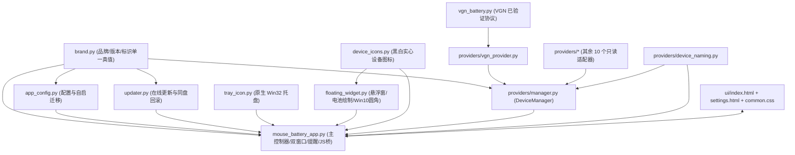

# PROJECT_CONTEXT.md — BattDock 权威技术架构文档

> 本文档基于 **BattDock v2.7.7** 正式版本源码整理，是跨会话开发与架构维护的权威参考。新开会话或上下文压缩后，请与 [`AGENTS.md`](./AGENTS.md)、[`PROGRESS.md`](./PROGRESS.md) 一并阅读。

---

## 1. 软件定位及主要功能

- **软件正式名称**：**BattDock**（轻量化 Windows 无线外设电量管理工具，开源协议 MIT）
- **核心定位**：免安装第三方厂商驱动套件、免内核驱动，在一处轻量双主题桌面界面与系统托盘中，通过只读 USB HID 与 Windows 蓝牙接口统一监控多品牌无线鼠标、无线键盘、无线耳机与分体耳塞的实时电量。
- **主要功能**：
  - 多品牌外设实时电量监控、充电/充满/休眠状态识别与分体耳塞（左/右/盒）三列展示；
  - 原生 Win32 系统托盘动态矢量电池图标（随电量/充电/三级低电量动态变色）与实时右键菜单；
  - 现代双窗口架构（主窗口 + 独立设置中心，浅色/深色/跟随系统主题与 Win10/11 圆角兼容）；
  - 每设备独立三级低电量提醒（滞回防抖、原生 WinForms 不抢焦点紧凑弹窗 + 系统通知 + 提示音）；
  - 原生 WinForms 轻量桌面悬浮窗（品牌精简显示、自定义名称、位置锁定、托盘双向开关）；
  - 零 Token GitHub Releases 在线更新（国内多节点高速通道优先 + 静默回退 GitHub、SHA-256 校验、同盘回滚与自动重启）；
  - 脱敏设备诊断报告一键复制与导出（供社区设备适配与排障，零隐私信息）。

---

## 2. 实际技术栈及框架版本

以下版本经本机开发环境实测核验（与 `requirements.txt` 及构建环境一致）：

| 类别 | 组件 / 工具 | 当前验证版本 | 用途说明 |
| :--- | :--- | :--- | :--- |
| 运行时 | Python | `3.12.10`（要求 `3.12+`） | 核心应用逻辑、HID 通信与构建脚本辅助 |
| HID 通信 | `hidapi`（`hid`） | `0.15.0`（`>=0.14.0`） | USB 2.4GHz / 有线外设 HID 只读枚举与报告收发 |
| 桌面 UI 宿主 | `pywebview` | `6.2.1`（`>=5.0`） | WinForms + Edge WebView2（`edgechromium`）渲染 HTML/CSS/JS |
| 图像与图标 | `Pillow`（`PIL`） | `13.0.0`（`>=10.0.0`） | 动态矢量电池图标、8x 超采样 SVG 设备图标与 ICO 渲染 |
| WinForms 互操作 | `pythonnet` / `clr-loader` | `3.2.1` / `0.3.1` | 宿主窗口精细控制、原生 WinForms 悬浮窗与紧凑提醒弹窗 |
| 系统托盘与原生 API | 自研 `tray_icon.py` + `ctypes` / `winreg` | 内置（`v2.7.3` 起移除运行时 `pystray` 依赖） | `Shell_NotifyIconW` 托盘、`SetupAPI` 蓝牙电量、DWM/HRGN 圆角、单实例互斥量、自启注册表 |
| 打包工具（构建期） | `PyInstaller` | `6.22.3` | 构建 `BattDock.exe` 目录版及旧版迁移桥接器 `VGNMouseBattery.exe` |
| 安装程序（构建期） | `Inno Setup 6` | `6.7.3` | 编译标准简体中文安装程序 `BattDock-vX.Y.Z-Setup.exe` |

- **兼容目标**：Windows 10 22H2 x64 及以上 / Windows 11 x64（依赖系统内置 Edge WebView2 运行时）。
- **本机实测硬件边界**：开发机为 Windows 11 x64，物理连接 `VGN Dragonfly F2 Pro Max (VID 0x3554, PID 0xFB3E)`，**无物理蓝牙适配器**（`BluetoothBatteryProvider` 在无蓝牙硬件时静默返回 `[]` 且零报错）。

---

## 3. 项目目录结构

当前标准本地目录为 `BattDock`（已完成由原历史目录 `vgn-mouse-battery` 原地改名）：

```text
BattDock/
├── brand.py                     # 品牌常量与版本号单一真值来源（BattDock / 2.7.7 / EXE / AUMID / 互斥量 / 仓库地址）
├── mouse_battery_app.py         # 主入口与核心控制器（主窗口/设置窗口生命周期、提醒弹窗、状态机、JS 桥、后台服务）
├── tray_icon.py                 # 自研独立原生 Win32 NotifyIcon 动态电池托盘控制器（含悬停回调与 Shell_NotifyIconGetRect）
├── tray_hover_popup.py          # 原生 WinForms 非激活托盘悬停紧凑电量浮层（Win10/11 圆角、多屏/四向任务栏锚定与限高滚动）
├── floating_widget.py           # 原生 WinForms 桌面悬浮窗、极简动态电池绘图、Win10/11 圆角与细边工具、提示音
├── app_config.py                # 配置持久化（%LOCALAPPDATA%\BattDock\config.json）、旧版配置与开机自启迁移
├── updater.py                   # 在线检查更新、国内加速优选、摘要提取、SHA-256/ZIP 校验、同盘回滚与重启脚本
├── device_icons.py              # 全局统一 24x24 黑白实心设备类型图标库（SVG + Pillow 8x 超采样）
├── vgn_battery.py               # 已真机验证的 VGN Dragonfly F2 Pro Max 17 字节只读 HID 协议实现
├── legacy_shim.py               # 旧版 VGNMouseBattery v2.2.0 自动升级至 BattDock 的过渡桥接启动器
├── providers/                   # 11 大模块化外设适配器与统一设备管理层
│   ├── __init__.py
│   ├── base.py                  # DeviceBattery / SubBattery / BatteryProvider / Win32 只读 HidP_GetCaps 工具
│   ├── manager.py               # DeviceManager（HID 快照缓存、串行锁、去重、专用认领表、脱敏诊断导出）
│   ├── device_naming.py         # 官方标准名称规范化、中文连接副标题、悬浮窗品牌标签与弹窗完整名
│   ├── vgn_provider.py          # VGN（封装 vgn_battery）/ VXE / ATK / CompX / MCHOSE / Rapoo
│   ├── logitech_hidpp.py        # Logitech HID++ 2.0 (0x1004/0x1000/0x1001/0x1F20 + 0x0005) & G 耳机
│   ├── razer_hid.py             # Razer 91 字节 Feature Report（鼠标 / 键盘）
│   ├── steelseries_hid.py       # SteelSeries 鼠标 & Arctis / Nova / GameBuds 耳机
│   ├── corsair_hid.py           # Corsair SLIPSTREAM Bragi (FF42:0001) 鼠键 & Void / HS70 / Virtuoso / HS80 耳机
│   ├── hyperx_hid.py            # HyperX Cloud 耳机 & Pulsefire 鼠标
│   ├── extra_brands.py          # ASUS ROG / TUF 鼠键/Omni/SpeedNova/耳机 & Sony INZONE 系列
│   ├── wireless_headsets.py     # Razer Audio / Logitech Centurion / ASTRO / JBL / EPOS / Airoha RACE / Alienware / Poly / Jabra / Fractal / 水月雨 / Sony PULSE 3D / MCHOSE / VGN OMNISOUND / FIFINE / Lenovo
│   ├── wireless_keyboards.py    # CompX BY / SONiX(隔离 QMK) / Evision / Semico / 荣元 2.4G / URX Core75 / MCHOSE K87 V3 / Alienware / Apple Magic Keyboard
│   ├── standard_hid.py          # 标准 USB HID Battery Strength (0x06:0x20) 零写操作通用兜底适配器
│   └── bluetooth_provider.py    # Windows SetupAPI DEVPKEY_Device_BatteryLevel MAC 聚合 + AirPods Continuity BLE 解析
├── ui/
│   ├── common.css               # 设计令牌、浅/深双主题、配色方案、--ui-zoom 圆角补偿、Win10 边框对齐与轻量动效
│   ├── index.html               # 主窗口（多设备卡片、低电量高亮卡、分体耳塞三列卡、空状态、底栏更新胶囊）
│   ├── settings.html            # 独立设置中心（6 分类导航、设备拖拽排序卡片、支持设备子页、关于与一键复制/导出诊断）
│   └── alert.html               # v1.x 遗留静态提醒模板（当前运行时由原生 WinForms 弹窗替代，保留未删）
├── assets/
│   ├── app_logo.png             # 512x512 纯黑圆角底 + 白色无线外设主 Logo（透明背景）
│   ├── app_icon.ico             # 9 规格多分辨率 Windows ICO（16–256px）
│   └── icons/*.svg              # mouse.svg / headset.svg / keyboard.svg / other.svg 统一实心矢量图标
├── installer/
│   ├── BattDock.iss             # Inno Setup 6 安装脚本（UTF-8 BOM，管理员安装 + users-modify + runasoriginaluser）
│   └── ChineseSimplified.isl    # 简体中文安装向导语言包（UTF-8 BOM，Microsoft YaHei UI）
├── tests/
│   └── test_providers.py        # 71 项自动化单元测试与核心生命周期/电量准确性/充电响应/托盘悬停/状态动效回归门禁
├── docs/screenshots/            # README 展示截图（v2.4.0 实拍与演示截图）
├── .github/ISSUE_TEMPLATE/      # Bug 反馈与设备适配申请模板
├── build_release.ps1            # 一键单测 → 独立全新目录 PyInstaller → Inno Setup → ZIP 打包 → SHA256SUMS.txt（零递归删除）
├── version_info.txt             # PyInstaller 嵌入的 Windows EXE 文件版本属性
├── requirements.txt             # 运行期 Python 依赖清单
├── 启动BattDock.vbs              # 源码模式无控制台启动脚本（规范名称）
├── 启动鼠标电量监控.vbs           # v1.x 历史无控制台启动脚本（与启动BattDock.vbs 等效，暂保留兼容）
├── AGENTS.md / PROJECT_CONTEXT.md / PROGRESS.md / SUPPORTED_DEVICES.md / RELEASE_CHECKLIST.md / CHANGELOG.md
├── README.md / README_EN.md / LICENSE / THIRD_PARTY_LICENSES.md
├── PROJECT.md                   # v1.x 历史项目文档归档（只读保留）
├── archive/                     # 已 gitignore 的历史备份与旧构建归档
└── release/                     # 已 gitignore 的本地构建输出与历史版本资产目录
```

---

## 4. 程序启动及退出流程

### 启动流程（`mouse_battery_app.py:main()` → `MouseBatteryApp.run()`）
1. **进程初始化（模块加载期）**：调用 `SetCurrentProcessExplicitAppUserModelID("BattDock.App")` 与 `SetProcessDpiAwareness(2)`（失败降级 `SetProcessDPIAware()`）。
2. **单实例校验（`_acquire_single_instance()`）**：同时申请 `Local\BattDock_SingleInstance` 与 `Local\VGNMouseBatteryMonitor_SingleInstance` 双互斥量；若任一已存在，则非 `--background` 模式调用 `_activate_existing_window()` 触发唤出事件后直接退出。
3. **旧版迁移与清理（仅冻结版 `IS_FROZEN`）**：
   - `load_config()` 内部调用 `migrate_legacy_config()` 无损复制旧配置；
   - `migrate_legacy_autostart()` 迁移旧开机自启键 `VGNMouseBattery` → `BattDock`；
   - 若带 `--cleanup-legacy-exe` 参数，2 秒后异步删除同目录过渡 `VGNMouseBattery.exe`。
4. **窗口预创建与零闪烁挂载**：安装 `_install_flicker_free_patch()`（`Opacity=0.0` + 主题背景色），创建无边框主窗口（`hidden="--background" in sys.argv`，`shadow=is_windows_11()`），进入 `webview.start(func=self._on_window_loaded, gui="edgechromium")`。
5. **后台服务单次初始化（`_start_background_services_once()`）**：受 `_bg_lock` + `_bg_started` 保护，绝不重复启动：
   - 挂载系统关机/注销监听 `_hook_os_session_ending()`；
   - 启动独立原生 Win32 托盘 `_start_tray()`；
   - 按配置同步桌面悬浮窗 `_sync_floating_widget()`；
   - 启动 4 个守护线程：`BattDock-Poll`、`BattDock-Wakeup`、`BattDock-ShowEvent`、`BattDock-DevChange`；
   - 若开启自动检查更新，12 秒后静默执行 `check_updates(silent=True)`。

### 退出流程（`MouseBatteryApp.quit_app()`）
1. 置位 `_quitting` 与 `_stop_event`，唤醒并停止后台轮询与监听线程。
2. 关闭桌面悬浮窗与低电量提醒弹窗，调用 `DeviceManager.close()` 释放所有常驻 HID 句柄（如 Sony PULSE 3D 只读句柄）。
3. **同步注销托盘**：调用 `TrayIconController.stop()` 发送 `NIM_DELETE` 销毁通知区域图标与 `HICON`，等待托盘线程退出，避免遗留僵尸图标。
4. 销毁设置窗口与主窗口，释放单实例互斥量；若处于在线更新流程，立即调用 `os._exit(0)` 彻底释放 WebView2 / CLR 文件锁，交由隐藏更新脚本完成替换并拉起新版。

---

## 5. 主窗口与设置窗口生命周期

- **零闪烁显现**：通过 `_install_flicker_free_patch()` 在 `BrowserForm.__init__` 预置 `Opacity=0.0`，在不可见态完成按显示器工作区居中（`_set_window_pos`）与圆角裁剪（`_apply_window_chrome`），待前端双 `requestAnimationFrame` 完成首帧合成并回调 `ui_ready()` 后平滑显现。严禁在句柄创建后修改 WinForms `ShowInTaskbar`（会触发 `RecreateHandle()` 引发 WebView2 `E_ABORT`）。
- **关闭与隐藏复用**：主窗口与设置窗口统一订阅 `events.closing`（`should_lock=True`）：
  - 主窗口在 `close_to_tray=True` 时取消销毁并隐藏至托盘，不销毁实例也不影响托盘与后台监控；`close_to_tray=False` 时触发 `quit_app()` 完整退出；
  - 设置窗口关闭始终隐藏复用（仅程序退出时销毁），每次重新打开默认重置至「常规设置」；
  - 托盘唤出或单实例唤醒 `show_main_window()` 校验 `_is_window_alive()`：若曾最小化（含「最小化后再右键关闭至托盘」），先 `SW_RESTORE` 再居中激活；若意外销毁则安全重建主窗口且绝不重复启动后台服务。
- **原生任务栏点击切换**：`_ensure_taskbar_toggle_style()` 幂等补齐 `WS_MINIMIZEBOX | WS_SYSMENU`（绝不添加 `WS_CAPTION`/`WS_THICKFRAME`/`WS_BORDER`），零全局钩子实现前台点击最小化、最小化恢复激活、后台可见置前不误最小化。
- **消除隐藏/重开残留悬停与焦点**：隐藏与显现前执行 `resetInteractionState()` 持久挂载 `:root.ui-await-pointer` 压制 Chromium 残留 `:hover`/`:active`，并递归 `EnumChildWindows` 向 `Chrome_RenderWidgetHostHWND` 投递 `WM_CANCELMODE`/`WM_MOUSELEAVE`，直至显现 120ms 后检测到真实位移 `> 3px` 的指针移动或点击才解除（不阻碍点击与键盘 `Tab` 导航）。

---

## 6. 系统托盘及 NotifyIcon 实现

自 `v2.7.3` 起彻底移除 `pystray 0.19.5`（根治其无锁 `HICON`/`HMENU` 竞态、忽略 `NIM_ADD` 返回值、权限异常崩溃及临时 `.ico` 磁盘写入四大缺陷），改用自研原生 Win32 **`tray_icon.py`（`TrayIconController`）**：

- **完全生命周期解耦**：在独立后台线程创建隐藏顶层消息窗口运行 Win32 消息循环，与主窗口/设置窗口的关闭、隐藏、最小化、重建及监控暂停完全解耦。
- **纯内存图标原子替换**：`draw_battery_icon()`（`floating_widget.py`）按任务栏物理像素栅格化细浅描边、圆润正极和按真实电量剪裁的实心填充。浅色任务栏增加细灰外缘，充电叠加白边黑色中央闪电，未知电量使用灰色。`pil_image_to_hicon()` 纯内存生成 32 位 ARGB `HICON`，`set_icon()` 在 `RLock` 内应用新图标后释放旧句柄。
- **悬停布局与快照**：可见浮层与图标的刷新复用同一设备快照和有效电量判断。正常行显示完整设备名（别名优先）及百分比，特殊状态才添加一行文字。可见设备行分别计高，滚动时按当前可见行重新计算。
- **高可靠自愈与悬停联动**：`NIM_ADD` 失败退避重试、`NIM_MODIFY` 失败自动补注册，监听 `WM_TASKBARCREATED` / `WM_DISPLAYCHANGE` / `WM_DPICHANGED` / `WM_SETTINGCHANGE` 自动恢复图标与同步主题；通过 `WM_MOUSEMOVE` + `Shell_NotifyIconGetRect` 联动 `tray_hover_popup.py` 紧凑悬停电量浮层（悬停 300ms 显示、移开 200ms 收起、独立非激活工具窗、Direct3D 独占全屏避让、开启时置空 `szTip` 防与原生 Tooltip 重复，外观设置关闭后立即恢复原生托盘提示）。
- **Win11 置顶兼容与实时菜单**：显式保持 `TRAY_UID = 0`，100% 兼容老用户在 Windows 11 `NotifyIconSettings` 中已设置的 `IsPromoted = 1` 置顶偏好；左键唤出主窗口，右键现场构建原生 `HMENU`（实时反映「显示桌面悬浮窗」勾选状态）并在使用后销毁；脱敏诊断报告附带 `tray` 健康状态快照。

---

## 7. HID / 蓝牙设备识别与电量读取架构

- **统一调度层（`providers/manager.py`）**：按顺序调度 11 个只读适配器：
  1. `VgnCompxProvider`（封装已真机验证的 `vgn_battery.py`）
  2. `LogitechHidppProvider`
  3. `RazerHidProvider`
  4. `SteelSeriesHidProvider`
  5. `CorsairHidProvider`
  6. `HyperXHidProvider`
  7. `ExtraBrandsProvider`（ASUS ROG / TUF、Sony INZONE）
  8. `WirelessHeadsetsProvider`（多品牌 2.4G/有线无线耳机，含迈从受控探测与 Sony PULSE 3D 常驻只读句柄）
  9. `WirelessKeyboardsProvider`（多品牌 2.4G/蓝牙键盘，180s 低打扰节流）
  10. `StandardHidBatteryProvider`（标准 USB HID `0x06:0x20` 通用只读兜底）
  11. `BluetoothBatteryProvider`（Windows SetupAPI 12 位 MAC 跨节点聚合 + AirPods Continuity BLE 解析）
- **去重与防冲突**：
  - 单次 `hid.enumerate(0, 0)` 快照共享给全部 HID 适配器，异常隔离；
  - `DeviceManager` 维护 `_dedicated_claimed_vps` 专用认领集合（含在线与休眠占位设备的精确 `(vid, pid)`），`StandardHidBatteryProvider` 精准跳过已认领设备防止重复卡片；
  - 同 `device_id` 按 `在线 > 有电量 > 充电中 > 已验证` 评分去重；
  - `sanitize_device_reading()` 统一通过 `providers/device_naming.py` 规范化显示名并强制保护「离线/未知电量绝不伪造 `0%`」。
- **已验证核心协议基线（`vgn_battery.py`，不可破坏）**：
  - `VGN Dragonfly F2 Pro Max`：`VID 0x3554`、`PID 0xFB3E`（2.4G）/ `0xFB3D`（有线），`Interface 1`，`Usage Page 0xFF02`，`Usage 0x0002`，17 字节 Report ID `0x08`，校验和 `sum(frame) % 256 == 0x55`，查询序列 `0x02(1) -> 0x03(1) -> 0x04 -> 0x02(0)`，连续 3 次无应答判休眠返回 `percent=None`。

---

## 8. 后台监控与轮询机制

- **事件驱动 HID 拓扑缓存**：`BattDock-DevChange` 线程监听 Windows `WM_DEVICECHANGE`（硬件插拔）与 `WM_POWERBROADCAST`（系统休眠/唤醒），仅在启动、热插拔、手动刷新、IO 异常恢复或长周期兜底（有设备 300s / 无设备 60s）时执行全量 `hid.enumerate(0, 0)`，消除常规轮询对 USB 总线的周期性阻塞。
- **串行防并发与退避降频**：`DeviceManager` 使用 `RLock` 串行轮询；`VgnBatteryReader` 复用共享快照、非阻塞排空并对休眠设备阶梯退避（`45s → 90s → 180s`）；`BattDock-Wakeup` 监听用户鼠标活动触发唤醒刷新并带 15 秒冷却。
- **轻量内存诊断**：`DeviceManager._poll_history` 使用最大 60 条的内存环形缓冲，默认零持续磁盘日志写入（仅环境变量 `BATTDOCK_DEBUG_LOG=1` 时写限长调试日志）。

---

## 9. 低电量提醒机制

- **状态机（`mouse_battery_app.py:evaluate_tiered_alerts()`）**：默认三级阈值 `30%`（一级黄「电量偏低」）、`20%`（二级橙「电量不足」）、`10%`（三级红「电量紧急」），支持单设备覆盖；引入 `+5%` 迟滞回升防抖与充电重置，同一轮跨越多个档位仅弹最紧急档位，可选重复提醒间隔。
- **展示载体**：
  - **原生 WinForms 独立最高置顶迷你弹窗**：按 `TextRenderer.MeasureText` 动态计算宽度（`250–360×56` 逻辑像素，圆角 `8px`），设为独立非模态窗（`Owner=None`），使用原生 Win32 `apply_non_activating_tool_style`（`WS_EX_NOACTIVATE | WS_EX_TOOLWINDOW | WS_EX_LAYERED`）+ `SetLayeredWindowAttributes` 淡入淡出 + `SetWindowPos(HWND_TOPMOST, SWP_NOACTIVATE | SWP_NOOWNERZORDER)` 实现独立最高置顶而不连带主/设置/悬浮窗置顶、不改变 `GetForegroundWindow()`，关闭前显式降级释放置顶；Direct3D 独占全屏游戏（`QUNS_RUNNING_D3D_FULL_SCREEN`）下暂缓弹窗不切屏，退出全屏后补提醒；
  - **Windows 系统通知与提示音**：可选经由 `TrayIconController.notify()` 推送气泡通知与 `play_alert_sound()` 播放系统提示音。

---

## 10. 桌面悬浮窗实现方式

- 实现于 `floating_widget.py`（`DesktopFloatingWidget`），基于原生 WinForms 窗体（零额外 WebView2 进程），经主窗体 UI 线程 `BeginInvoke` 刷新；全程使用原生 Win32 扩展样式（`WS_EX_NOACTIVATE | WS_EX_TOOLWINDOW | WS_EX_LAYERED`）、`SetLayeredWindowAttributes` 与状态签名差异更新（无变化轮询零 Win32/DWM/重绘扰动），并缓存复用 GDI 字体；Direct3D 独占全屏游戏期间静默隐藏、退出后自动恢复。
- **内容与交互**：黑白实心设备图标、紧凑设备名、百分比、充电闪电及与设备名称对齐的平滑电量条。自动模式显示多设备，支持指定设备和仅最低电量模式。别名和悬停详情沿用已有配置，Win10 使用 `paint_winforms_rounded_border()` 绘制细边。窗口尺寸按托盘工作区所在显示器的 DPI 缩放。
- 支持透明度（`40%–100%`）、小/中/大尺寸、四角预设与自由拖拽坐标持久化、位置锁定、指定设备或自动跟随、双击唤出主窗口，以及系统托盘右键与设置页双向实时开关。

---

## 11. 用户配置存储方式

- 实现于 `app_config.py`：
  - **打包运行模式（`IS_FROZEN=True`）**：存储于 `%LOCALAPPDATA%\BattDock\config.json`；首次启动自动检查 `%LOCALAPPDATA%\VGNMouseBattery\config.json`，目标不存在时无损复制迁移。
  - **源码运行模式（`IS_FROZEN=False`）**：存储于项目根目录 `config.json`（已列入 `.gitignore`）。
- **数据结构**：`AppConfig` 涵盖窗口坐标尺寸、主题、界面缩放、动画开关、配色方案、全局轮询间隔、关窗至托盘、自动检查更新、三级阈值规则 `tier_rules`、提醒方式、每设备独立偏好 `device_prefs`（`DevicePreference`：别名/隐藏/监控开关/排序权重/自定义阈值）与悬浮窗配置 `floating`（`FloatingWidgetConfig`）。
- **向后兼容清洗**：旧配置中窗口尺寸过小（`< 600×400`）自动纠正为 `760×480`；已移除的旧版界面线路字段（`update_source`/`update_custom_mirror`）在加载时重置为默认自动优选（`"auto"`/`""`），防老配置残留失效镜像锁死。

---

## 12. 在线更新及自动重启机制

- 实现于 `updater.py`（零第三方网络依赖，兼容系统代理）：
  - **版本检查**：默认国内加速通道优先（通过 `CN_GITHUB_MIRRORS` 4 节点读取 `releases/latest/download/update-summary.json`），失败静默回退 GitHub 官方 API（`LATEST_RELEASE_API`），严格过滤 `draft` 与 `prerelease`。
  - **资产选择与安全校验**：`select_release_asset()` 强制匹配含 `battdock` 与 `portable` 且排除 `bridge` 的 HTTPS `.zip` 资产；下载前并发测速择优（`rank_candidate_urls()`）并支持节点故障无缝切换；下载后校验 `SHA256SUMS.txt` 与 ZIP 防路径遍历（Zip Slip）及主程序 `BattDock.exe` 存在性。
  - **原地替换、同盘回滚与自动重启**：生成 UTF-8 BOM PowerShell 脚本并以 `CREATE_NO_WINDOW | CREATE_NEW_PROCESS_GROUP` + `DEVNULL` 启动；主进程同步 `NIM_DELETE` 注销托盘并 `os._exit(0)` 释放锁；脚本在目标程序**同盘目录**建立 `._battdock_rollback_<pid>` 仅移出旧 `BattDock.exe` 与 `_internal`（绝不触碰用户无关文件），复制新版失败自动完整回滚，成功后顺手清理旧 `VGNMouseBattery.exe` 与旧自启项、自动重启新版 `BattDock.exe` 并核验 PID 存活、清理全部临时文件。

---

## 13. GitHub 仓库及发布流程

- **公开仓库**：`https://github.com/edwin99701/BattDock`（主分支 `master`，当前最新正式版 `v2.7.7`；原历史仓库名 `wireless-peripheral-battery-monitor`）。
- **旧仓库迁移与重定向兼容说明**：仓库已正式更名为 `BattDock`，经 Python 3.12 实网测试验证，旧版客户端（`v2.2.0–v2.7.4`）使用的旧 GitHub API、`releases/latest/download/update-summary.json`、`SHA256SUMS.txt` 及安装包/便携版直连与全部 4 个国内加速节点均通过 GitHub 301 重定向正常可用；未来版本统一使用新仓库地址（切勿在同账号下重建同名旧仓库 `wireless-peripheral-battery-monitor`，以免覆盖重定向）。
- **标准构建与发布流程**：
  1. 版本递增：同步更新 `brand.py`、`version_info.txt`、`installer/BattDock.iss` 默认版本、`CHANGELOG.md`、`PROGRESS.md`、`PROJECT_CONTEXT.md`、`README.md`、`README_EN.md`。
  2. 一键构建：运行 `powershell -ExecutionPolicy Bypass -File .\build_release.ps1`，自动跑通全部 71 项单元测试，并在全新独立构建目录生成 `release\assets_vX.Y.Z\` 下的 `BattDock-vX.Y.Z-Setup.exe`、`BattDock-vX.Y.Z-Windows-x64-Portable.zip`、`VGNMouseBattery-vX.Y.Z-win64-UpgradeBridge.zip` 与 `SHA256SUMS.txt`（零递归删除，完整保留已有正式资产）。
  3. 准备 `update-summary.json`（3–5 条简明中文摘要）与纯文本 Release 正文（无 `•`/Markdown 噪音/HTML 注释）。
  4. 按 `RELEASE_CHECKLIST.md` 完成隐私扫描与回归核验，提交并打附注标签 `git tag -a vX.Y.Z -m "BattDock vX.Y.Z"`，推送 `master` 与 tag。
  5. 执行 `gh release create vX.Y.Z --draft ...` → 核验 5 个资产均已上传 → `gh release edit vX.Y.Z --draft=false --latest` → 线上验证 `updater.check_for_update()` 与资产直链 HTTP 200。

---

## 14. Windows 10 / 11 兼容性处理

- **圆角与边框**：
  - **Windows 11（Build `>= 22000`）**：`shadow=True` + 原生 `DWMWA_WINDOW_CORNER_PREFERENCE = DWMWCP_ROUND` + `DWMWA_BORDER_COLOR = NONE`。
  - **Windows 10（Build `< 22000`）**：禁用 `pywebview` 默认阴影（`shadow=is_windows_11()`），在 `apply_window_rounded_corners()` 中显式关闭非客户区 DWM 渲染（`DWMNCRP_DISABLED`）并清零 `DwmExtendFrameIntoClientArea(0,0,0,0)`，消除 1px 白色直角外框；使用显式 64 位 `HRGN` 签名的 `CreateRoundRectRgn(0, 0, w+1, h+1, diam, diam)` + `SetWindowRgn` 按真实 DPI 裁剪；最大化清除裁剪区域、最小化 `IsIconic` 跳过重算，并在 `SizeChanged`/`Resize`/`VisibleChanged`/`DpiChanged` 同步重算。
- **任务栏与托盘**：原生 Win32 样式补齐 `WS_MINIMIZEBOX | WS_SYSMENU` 兼容 Win10/11 任务栏切换；托盘 `uID=0` 保持 Win11 托盘置顶偏好，并兼容 Win10 通知区经典行为。
- **安装与更新权限**：Inno Setup 使用 `PrivilegesRequired=admin` + `[Dirs] Name: "{app}"; Permissions: users-modify` + `[Run] runasoriginaluser`，同时实现任意盘符无报错安装、普通用户权限软件内自动更新及正确用户配置目录定位。

---

## 15. 重要模块之间的依赖关系



---

## 16. 软件名称、程序文件名及内部标识对应关系

| 维度 | 当前正式标准（BattDock） | 历史旧标识（仅兼容迁移使用） | 说明 |
| :--- | :--- | :--- | :--- |
| 对外产品名称 | `BattDock` | `VGNMouseBattery` / `VGN 鼠标电量` | 统一定义于 `brand.py` |
| 本地项目目录 | `BattDock`（原目录 `vgn-mouse-battery`） | `vgn-mouse-battery` | 已完成原地改名并保留完整 `.git` 历史 |
| 主程序文件名 | `BattDock.exe` | `VGNMouseBattery.exe` | 安装与更新后自动清理旧 EXE |
| 安装程序命名 | `BattDock-v<版本号>-Setup.exe` | 无（`v2.5.0` 起引入） | Inno Setup `AppId` 固定原地覆盖 |
| 便携版命名 | `BattDock-v<版本号>-Windows-x64-Portable.zip` | `VGNMouseBattery-v2.2.0-win64.zip` | 兼容现有 `v2.3.0–v2.7.3` 更新器 |
| 旧版迁移桥接包 | `VGNMouseBattery-v<版本号>-win64-UpgradeBridge.zip` | 仅服务 `v2.2.0` 旧版 | 内含 `legacy_shim.py` 过渡启动器 |
| AppUserModelID | `BattDock.App` | 无 | 任务栏分组、Alt+Tab 与通知来源 |
| 配置目录 | `%LOCALAPPDATA%\BattDock\config.json` | `%LOCALAPPDATA%\VGNMouseBattery\config.json` | 首次启动自动无损复制迁移 |
| 开机自启键 | `HKCU\...\Run\BattDock` | `HKCU\...\Run\VGNMouseBattery` | 启动/安装/更新/桥接四重自动迁移清理 |
| 单实例互斥量 | `Local\BattDock_SingleInstance` | `Local\VGNMouseBatteryMonitor_SingleInstance` | 同时申请双互斥量防新旧共存 |
| 窗口唤醒事件 | `Local\BattDock_ShowEvent` | `Local\VGNMouseBatteryMonitor_ShowEvent` | 同时监听双事件防唤醒失效 |
| GitHub 公开仓库 | `edwin99701/BattDock` | `edwin99701/wireless-peripheral-battery-monitor` | 已正式更名，GitHub 301 重定向兼容旧版直连与国内 4 节点（严禁重建同名旧仓库） |
| 保留原名内部模块 | `mouse_battery_app.py`、`vgn_battery.py`、`providers/vgn_provider.py` | 同左 | 职责清晰且牵涉入口/自启/测试，不强行改名 |
