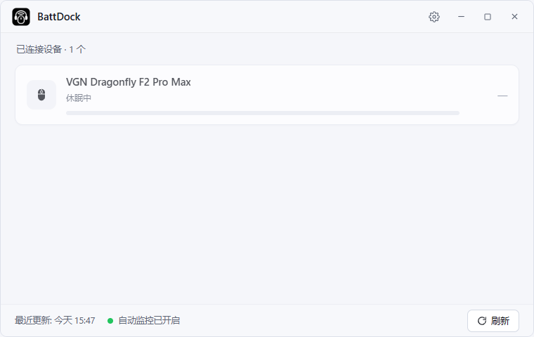
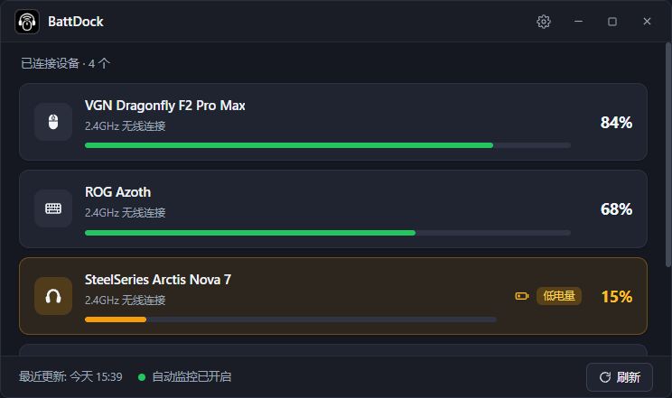
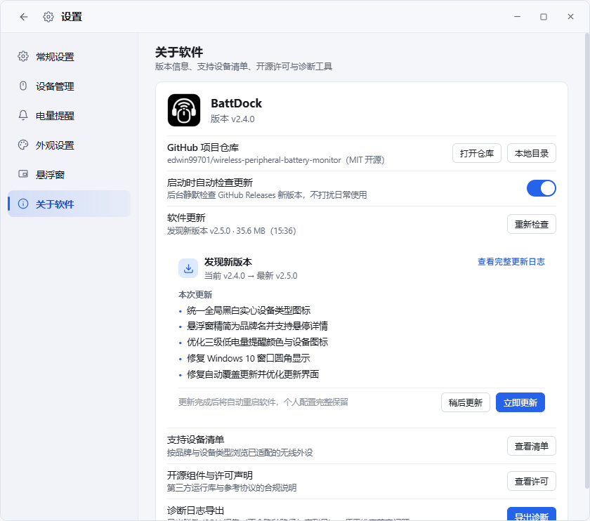
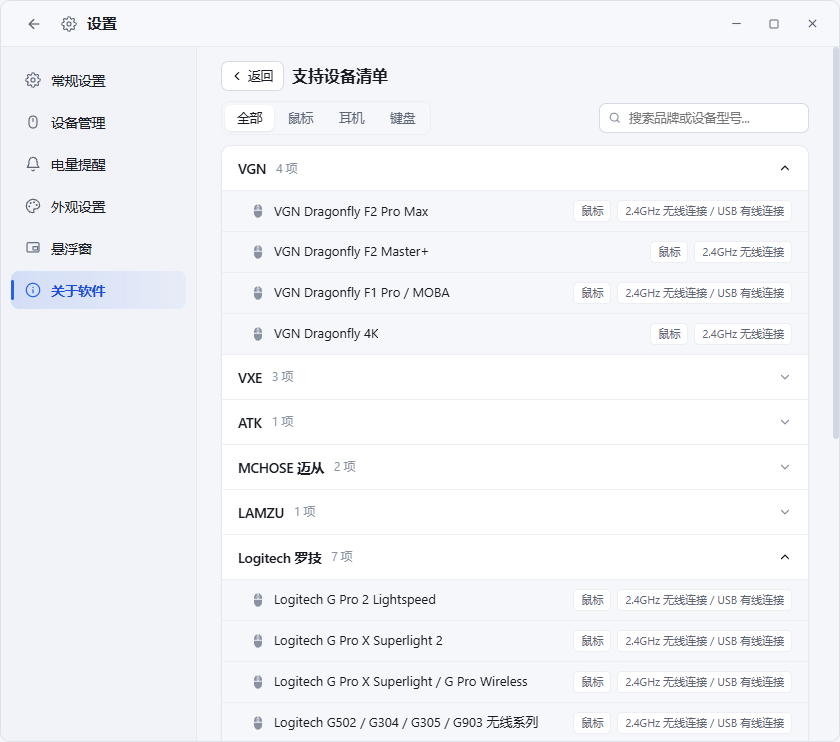

<div align="center">


# BattDock

**轻量化 Windows 无线外设电量管理工具**

[](https://github.com/edwin99701/wireless-peripheral-battery-monitor/releases/latest)
[](https://github.com/edwin99701/wireless-peripheral-battery-monitor/releases/latest)
[](./LICENSE)
[](https://github.com/edwin99701/wireless-peripheral-battery-monitor/releases)

**简体中文** · [English](./README_EN.md)

<br />

<a href="https://github.com/edwin99701/wireless-peripheral-battery-monitor/releases/latest">
  
</a>

</div>

---

## 软件简介

**BattDock** 致力于在一处轻量、简洁的界面中统一管理多个品牌无线外设的实时电量，让您无需为了查看电量而同时在后台常驻多套庞大的官方驱动软件。

- **免装第三方驱动**：通过标准 Windows HID 与只读蓝牙系统接口获取电量，绝不安装内核驱动或修改设备 DPI / 灯光 / 固件设置。
- **使用边界说明**：
  - 蓝牙电量读取依赖本机蓝牙适配器及 Windows 蓝牙电量服务（无蓝牙硬件时自动静默跳过，不影响 2.4GHz USB 设备）；
  - 极少数仅通过闭源加密驱动通信的设备无法免驱读取；离线或休眠设备会明确显示「休眠中」或「—」，绝不伪造 `0%` 电量。

---

## Features · 核心功能

| | |
| :--- | :--- |
| **实时电量监控**<br>统一黑白实心设备类型图标（鼠标/耳机/键盘），多品牌统一管理、自动热插拔与规范型号命名 | **三级低电量提醒**<br>默认 `30% / 20% / 10%` 黄/橙/红分级提醒、统一实心设备图标与不抢游戏焦点的 5 秒迷你弹窗 |
| **动态托盘电池**<br>系统托盘图标随实际电量填充与低电量色阶联动，仅状态变化时刷新，零冗余后台开销 | **桌面悬浮窗**<br>原生 WinForms 轻量悬浮窗（默认精简为品牌名 + 悬停完整详情 + 同品牌自动区分），支持自定义名与位置锁定 |
| **Win10 / 11 原生圆角与双主题**<br>浅色 / 深色 / 跟随系统自适应，Win11 原生 DWM 圆角 + Win10 兼容外轮廓圆角，轻量平滑动效 | **一键在线更新与自动重启**<br>软件内展示简明更新摘要，支持真实进度下载、SHA-256 完整性校验、同盘安全回滚与自动重启升级 |

---

## 界面截图

> 以下均为 **BattDock v2.4.0** 实际运行截取画面。主窗口深色模式为展示统一设备图标、多设备卡片与分体耳塞独立电量的**演示界面**，不代表对应全部外设均已完成实体硬件测试（真实硬件验证状态见下方表格与 [`SUPPORTED_DEVICES.md`](./SUPPORTED_DEVICES.md)）。

<table>
  <tr>
    <td width="50%" align="center">
      <br />
      <sub><b>主窗口 · 浅色模式</b>（本机 VGN Dragonfly F2 Pro Max 实拍）</sub>
    </td>
    <td width="50%" align="center">
      <br />
      <sub><b>主窗口 · 深色模式</b>（统一黑白设备图标与多设备演示界面）</sub>
    </td>
  </tr>
  <tr>
    <td width="50%" align="center">
      <br />
      <sub><b>设置中心</b>（常规 / 设备管理 / 电量提醒 / 外观 / 悬浮窗 / 关于）</sub>
    </td>
    <td width="50%" align="center">
      <br />
      <sub><b>软件内在线更新</b>（简明更新摘要、真实下载进度与自动重启升级）</sub>
    </td>
  </tr>
</table>

<div align="center">
  <br />
  <sub><b>支持设备清单</b>（独立品牌折叠列表、统一设备图标、类型筛选与实时搜索）</sub>
  <br /><br />
  <br />
  <sub><b>系统托盘动态电池图标</b>（正常 / 充电 / 三级低电量 / 离线休眠）</sub>
  <br /><br />
  
  &nbsp;&nbsp;&nbsp;&nbsp;
  <br />
  <sub><b>精简品牌桌面悬浮窗</b>（左）与 <b>统一设备图标三级低电量提醒</b>（右）</sub>
</div>

---

## 支持设备概览

完整型号、VID/PID、协议来源及官网核实依据请查阅 [**支持设备清单（SUPPORTED_DEVICES.md）**](./SUPPORTED_DEVICES.md)。

| 品牌 | 覆盖设备类型 | 连接方式 | 当前验证状态 |
| :--- | :--- | :--- | :--- |
| **VGN**（Dragonfly F2 Pro Max） | 无线鼠标 | 2.4GHz 无线连接 / USB 有线连接 | **已实机验证** |
| **VGN / VXE / ATK / MCHOSE / LAMZU** | 无线鼠标、无线键盘、无线耳机（OMNISOUND / X9 / V9 Pro 等） | 2.4GHz 无线连接 / USB 有线连接 | 协议已适配，待实机验证 |
| **AULA / AJAZZ / Attack Shark / CHERRY / EPOMAKER / Redragon / Alienware / URX** | 2.4GHz / 三模无线键盘（CompX BY / SONiX / Evision / Semico / 荣元 2.4G / URX Core75） | 2.4GHz 无线连接 / USB 有线连接 | 协议已适配，待实机验证 |
| **Logitech 罗技 / ASTRO** | 无线鼠标、键盘、G 系列与 Centurion / ASTRO A50 / A20 X 无线耳机 | 2.4GHz 无线连接 / 蓝牙连接 / USB 有线连接 | 协议已适配，待实机验证 |
| **Razer 雷蛇** | 无线鼠标、无线键盘（11 款）、BlackShark / Kraken / Barracuda 无线耳机 | 2.4GHz 无线连接 / USB 有线连接 | 协议已适配，待实机验证 |
| **SteelSeries 赛睿** | 无线鼠标、Arctis 1/7/9/Pro / Nova 5/7/Pro/Elite 无线耳机与 GameBuds | 2.4GHz 无线连接 / USB 有线连接 | 协议已适配，待实机验证 |
| **Corsair 海盗船** | SLIPSTREAM 鼠键（含 K70 Core TKL / MAKR 75）、Void / HS70 / HS80 / Virtuoso 耳机 | 2.4GHz 无线连接 / USB 有线连接 | 协议已适配，待实机验证 |
| **HyperX** | Cloud Alpha / Alpha 2 / II / III / III S / Flight / Stinger 耳机、Pulsefire 鼠标 | 2.4GHz 无线连接 / USB 有线连接 | 协议已适配，待实机验证 |
| **ASUS ROG / TUF** | 无线鼠标、键盘、Omni 接收器、ROG 耳机 | 2.4GHz 无线连接 / USB 有线连接 | 协议已适配，待实机验证 |
| **JBL / EPOS / Audeze / AKG / Skullcandy / Jabra / Poly / Fractal / 水月雨 / Alienware** | Quantum 全系（含 520X）、H3PRO、Maxwell / 2、N9、PLYR、Jabra Link、Poly BT600、Scape、GM01 Pro、AW920H 等 | 2.4GHz 无线连接 / USB 有线连接 | 协议已适配，待实机验证 |
| **Sony 索尼** | INZONE H5 / H9 II / Buds、PULSE 3D、WH-1000XM5 等 | 2.4GHz 无线连接 / 蓝牙连接 | 协议已适配，待实机验证 |
| **iKF / 漫步者 / Keychron / NuPhy / Apple & 标准蓝牙 / 标准 HID 通用设备** | iKF / 漫步者 / Bose / Sennheiser / Marshall / Shokz 蓝牙耳机，Keychron / NuPhy / RK / Akko / DAREU / Lofree 蓝牙键盘，AirPods / Magic Keyboard 及标准 USB HID `0x06:0x20` 通用外设 | 蓝牙连接 / 2.4GHz / USB 标准 HID | 协议已适配，待实机验证 |

> 实际兼容性可能因设备固件版本与连接方式而异；部分旧款雷柏（Rapoo）私有加密协议设备目前暂不支持。

---

## 下载与安装

### 系统要求
- **操作系统**：Windows 10 22H2 x64 及以上 / Windows 11 x64（依赖系统内置 Edge WebView2 运行时，无需安装 Python）。

### 发布产物说明
前往 [GitHub Releases](https://github.com/edwin99701/wireless-peripheral-battery-monitor/releases/latest) 下载（国内用户可直接点击下方国内加速直链）：
- **`BattDock-v2.7.0-Setup.exe`**（**推荐，Windows 标准安装程序**）：双击下一步即可安装（支持任意盘符与自定义路径），自动配置目录读写权限、创建桌面与开始菜单快捷方式，支持 Windows「应用与功能」一键标准卸载及后续软件内一键自动覆盖更新。
  - 国内高速下载：[国内加速节点 1](https://gh-proxy.org/https://github.com/edwin99701/wireless-peripheral-battery-monitor/releases/download/v2.7.0/BattDock-v2.7.0-Setup.exe) ｜ [国内加速节点 2](https://ghfast.top/https://github.com/edwin99701/wireless-peripheral-battery-monitor/releases/download/v2.7.0/BattDock-v2.7.0-Setup.exe)
- **`BattDock-v2.7.0-Windows-x64-Portable.zip`**（**绿色便携版**）：免安装，解压至任意本地目录后双击 `BattDock.exe` 即可运行。
  - 国内高速下载：[国内加速节点 1](https://gh-proxy.org/https://github.com/edwin99701/wireless-peripheral-battery-monitor/releases/download/v2.7.0/BattDock-v2.7.0-Windows-x64-Portable.zip) ｜ [国内加速节点 2](https://ghfast.top/https://github.com/edwin99701/wireless-peripheral-battery-monitor/releases/download/v2.7.0/BattDock-v2.7.0-Windows-x64-Portable.zip)
- **`SHA256SUMS.txt`**：所有发布文件的 SHA-256 校验值清单，用于核对文件完整性。
- **`update-summary.json`**：供软件内部直接读取的简明中文更新摘要。
- **`VGNMouseBattery-v2.7.0-win64-UpgradeBridge.zip`**：仅供早期 `v2.2.0` 旧版平滑升级迁移使用，新用户无需手动下载。

> **升级说明**：软件内默认已开启**国内加速自动优选**（支持多节点测速择优、失败自动切源、自定义 HTTPS 加速前缀与 SHA-256 强制校验），可在「设置 → 关于软件 → 更新下载线路」随时切换。已安装 `v2.4.0`–`v2.6.1` 的用户可直接点击软件内「立即更新」一键升级。

### 首次启动与在线更新
1. **开机静默自启**：在安装向导或「设置 → 常规设置」中开启开机自启，默认以 `--background` 静默驻留系统托盘，不弹出窗口。
2. **国内加速在线更新**：在「设置 → 关于软件」可切换下载线路（默认「自动优选（国内加速）」）；点击「检查更新 → 立即更新」后自动择优高速下载、实时显示当前线路与速率、强制校验 SHA-256 完整性并自动重启完成升级。
3. **配置保存与卸载**：个人配置保存于 `%LOCALAPPDATA%\BattDock\config.json`（旧版 `VGNMouseBattery` 配置首次启动时自动无损迁移）；安装版可在 Windows「设置 → 应用」中一键卸载，便携版可运行目录内的 `卸载BattDock.bat`。

### 常见问题与排查
- **未显示设备或显示 `—`**：请确认 2.4GHz 接收器已插稳或设备未进入深度休眠（晃动鼠标即可自动唤醒并刷新）。
- **在线更新下载缓慢或失败**：软件自动遵循 Windows 系统代理；如网络无法直连 GitHub，可点击更新面板中的「前往下载页」手动下载压缩包覆盖程序目录（个人配置不会丢失）。
- **提交新设备兼容反馈**：点击「设置 → 关于软件 → 导出诊断」生成脱敏 `diagnostics_*.json`，对照设备适配模板提交 Issue 即可。

---

## 开发与贡献

### 本地运行与构建

```powershell
# 1. 安装依赖（Python 3.12+）
pip install -r requirements.txt

# 2. 运行全部单元测试（38 项）
python -m unittest discover -s tests -v

# 3. 源码启动 BattDock
python mouse_battery_app.py

# 4. 一键测试并构建 Windows 便携版与 SHA256SUMS.txt
powershell -ExecutionPolicy Bypass -File .\build_release.ps1
```

### 参与贡献
欢迎提交 Issue 与 Pull Request：
- 遇到问题请使用 [Bug 反馈模板](./.github/ISSUE_TEMPLATE/bug_report.md)；
- 申请适配新外设请使用 [设备适配申请模板](./.github/ISSUE_TEMPLATE/device_support.md)。
- **隐私提醒**：在公开 Issue 中反馈问题时，请**不要**上传包含个人用户名、本地绝对路径、设备序列号或其他敏感信息的完整日志。

---

## 开源许可

本项目代码基于 [**MIT License**](./LICENSE) 开源发布。第三方运行库与公开硬件协议参考的详细许可证合规声明请参阅 [**THIRD_PARTY_LICENSES.md**](./THIRD_PARTY_LICENSES.md)。
