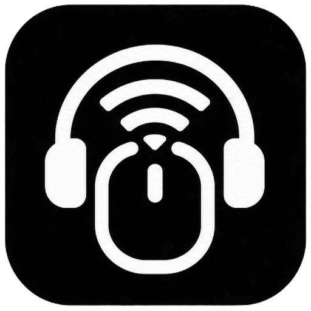
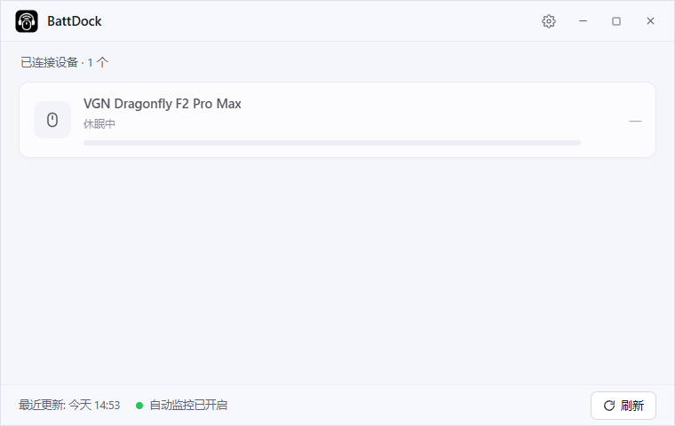
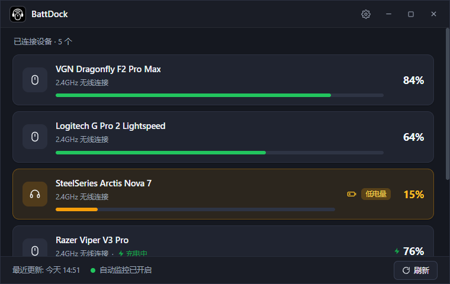
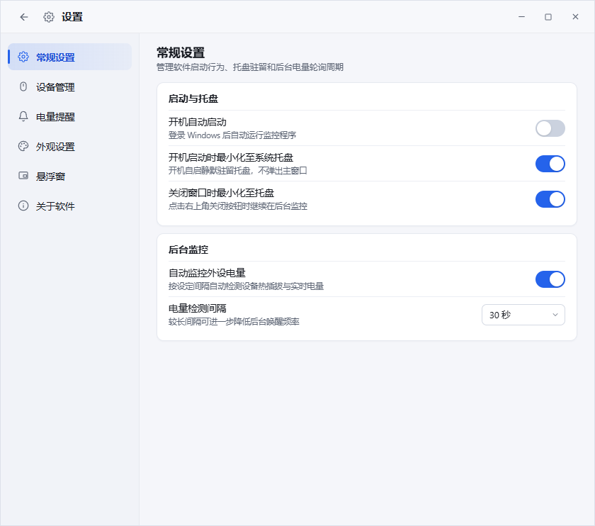
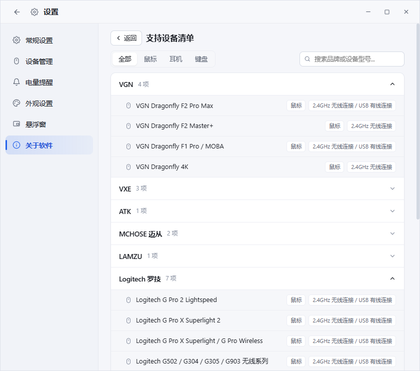

<div align="center">



# BattDock

**A lightweight Windows battery monitor for wireless mice, keyboards, headsets, and other peripherals.**

[](https://github.com/edwin99701/wireless-peripheral-battery-monitor/releases/latest)
[](https://github.com/edwin99701/wireless-peripheral-battery-monitor/releases/latest)
[](./LICENSE)
[](https://github.com/edwin99701/wireless-peripheral-battery-monitor/releases)

[简体中文](./README.md) · **English**

<br />

<a href="https://github.com/edwin99701/wireless-peripheral-battery-monitor/releases/latest">
  
</a>

</div>

---

## Overview

**BattDock** is a lightweight desktop utility for Windows 10 and Windows 11 that monitors the real-time battery level of wireless mice, keyboards, headsets, and earbuds across multiple brands — without requiring bulky vendor suites running in the background.

- **Read-Only & Driverless**: Uses standard Windows HID and read-only Bluetooth APIs. Installs no kernel drivers and never writes DPI, RGB, or firmware settings.
- **Transparent Limitations**: Bluetooth battery reading requires a Bluetooth adapter supported by Windows; asleep or unreachable devices show `—` rather than a fabricated `0%`.

---

## Key Features

- **Multi-Brand Support**: Hardware-verified on `VGN Dragonfly F2 Pro Max`, with built-in read-only adapters for Logitech (HID++ 2.0 & G headsets), Razer, SteelSeries, Corsair, HyperX, ASUS ROG / TUF, Sony INZONE, VXE / ATK / MCHOSE / LAMZU, Apple AirPods / Beats, and standard Windows Bluetooth Battery Service devices.
- **Dynamic System Tray Battery Icon**: Vector battery fill and color dynamically track real-time charge and alert thresholds, updating only when device state changes.
- **3-Tier & Custom Low-Battery Alerts**: Default `30% / 20% / 10%` thresholds with hysteresis, optional repeat intervals, system sounds, and a non-intrusive 5-second top-most mini popup that never steals fullscreen/game focus.
- **Native Desktop Floating Widget**: Lightweight WinForms overlay (zero extra WebView2 overhead) with customizable opacity, size, position presets, and lock toggle.
- **Light / Dark / System Themes & Smooth Motion**: Clean Win10/11-compatible dual-window UI with 150–220ms subtle transitions and reduced-motion support.
- **Built-In Online Updates**: Token-free GitHub Releases update checker with SHA-256 verification, safe rollback, and zero-loss config preservation.

---

## Screenshots

> Captured from actual **BattDock v2.3.0** runs. The Dark Mode screenshot shows a **demo multi-device view** to illustrate card layouts and split-earbud indicators (see [`SUPPORTED_DEVICES.md`](./SUPPORTED_DEVICES.md) for actual hardware verification status).

<table>
  <tr>
    <td width="50%" align="center">
      <br />
      <sub><b>Main Window · Light Mode</b> (Real VGN hardware)</sub>
    </td>
    <td width="50%" align="center">
      <br />
      <sub><b>Main Window · Dark Mode</b> (Multi-device demo)</sub>
    </td>
  </tr>
  <tr>
    <td width="50%" align="center">
      <br />
      <sub><b>Settings Center</b></sub>
    </td>
    <td width="50%" align="center">
      <br />
      <sub><b>Supported Devices</b> (Collapsible brand catalog)</sub>
    </td>
  </tr>
</table>

---

## Download & Installation

1. Go to [GitHub Releases](https://github.com/edwin99701/wireless-peripheral-battery-monitor/releases/latest) and download **`BattDock-v2.3.0-Windows-x64-Portable.zip`**.
2. Extract to any folder and launch **`BattDock.exe`** (requires Windows 10 22H2 x64+ or Windows 11 x64).
3. Settings are stored in `%LOCALAPPDATA%\BattDock\config.json` and preserved across updates. Legacy `VGNMouseBattery` configurations and autostart entries migrate automatically on first launch.

---

## Development

```powershell
pip install -r requirements.txt
python -m unittest discover -s tests -v
python mouse_battery_app.py
powershell -ExecutionPolicy Bypass -File .\build_release.ps1
```

## License

Released under the [MIT License](./LICENSE). See [THIRD_PARTY_LICENSES.md](./THIRD_PARTY_LICENSES.md) for third-party libraries and protocol references.
